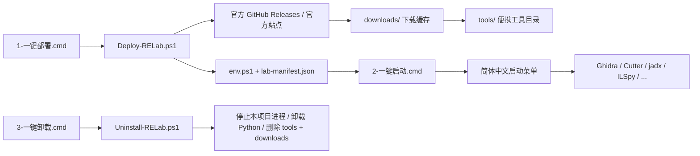

# RE Lab

**Windows 一键部署的便携逆向工程工具包。**  
简体中文启动器 · 一键部署 · 一键卸载 · 不污染系统 PATH · 不把工具装进 `Program Files`。

[](https://www.microsoft.com/windows)
[](https://learn.microsoft.com/powershell/)
[](LICENSE)
[](#)

---

## 这是什么

RE Lab 是一个面向 Windows 的**开源逆向工程工具包安装器**。

它把常用的开源逆向工具集中到一个便携目录里，用三个双击文件完成：

- **一键部署**：从官方 GitHub Releases / 官方站点下载、解压、配置环境。
- **一键启动**：简体中文菜单，每个工具带一句用途说明。
- **一键卸载**：停止本工具包启动的进程、卸载 Python、删除工具和缓存。

所有工具都放在 `tools\` 下，下载缓存放在 `downloads\` 下。部署脚本不会把工具写进系统 `PATH`，也不会安装到 `Program Files`。删除目录或运行卸载脚本即可清理。

> 本项目只用于对你拥有或已获授权分析的软件、恶意样本、CTF、互操作性研究。不得用于绕过软件授权、DRM、他人系统的安全机制或实施攻击。

---

## 特性

- **三个入口，双击即用**：`1-一键部署.cmd`、`2-一键启动.cmd`、`3-一键卸载.cmd`。
- **简体中文启动器**：工具名称、类型、用途全部中文说明；新手可直接按提示选择。
- **官方来源**：工具来自各自项目的官方 GitHub Releases 或官方站点。
- **完整性校验**：Ghidra 使用官方 SHA-256 校验；下载文件做大小和 ZIP 完整性检查。
- **多线程下载**：大文件分段并发下载；支持缓存，重复运行跳过已下载文件。
- **代理可关闭**：默认使用 GitHub 加速代理，`-NoProxy` 可直连官方源。
- **不污染系统**：工具、Python、Node 都在项目目录内；不修改系统 PATH。
- **可迁移**：整个文件夹移动到别的目录后，重新运行部署脚本即可重建路径配置。
- **可审计**：安装报告、工具清单、部署日志都保存在项目目录。
- **一键卸载**：只停止本项目启动的进程，不影响系统里其他 Python/Java 程序。

---

## 快速开始

### 1. 一键部署

双击：

```text
1-一键部署.cmd
```

首次会下载约 **1.2 GB** 压缩包，完整解压后约 **4 GB**。请保持网络连接，不要关闭窗口。

也可以在 PowerShell 中运行：

```powershell
powershell -NoProfile -ExecutionPolicy Bypass -File .\Deploy-RELab.ps1
```

### 2. 一键启动

双击：

```text
2-一键启动.cmd
```

菜单会列出所有工具，输入编号回车即可。  
新手建议输入 `2` 启动 **Cutter**（自带简体中文），或按 `H` 打开《新手速查表》。

### 3. 一键卸载

双击：

```text
3-一键卸载.cmd
```

输入 `YES` 确认。卸载会删除 `tools\`、`downloads\` 和生成的配置，释放约 4 GB；启动脚本和文档会保留，方便以后重新部署。

---

## 工作流程



---

## 包含的工具

| 类别 | 工具 | 版本 | 用途 |
|---|---|---|---|
| 反汇编/反编译 | [Ghidra](https://github.com/NationalSecurityAgency/ghidra) | 12.2 | 多架构反汇编、反编译（英文界面） |
| 反汇编/反编译 | [radare2](https://github.com/radareorg/radare2) | 6.2.6 | CLI 逆向框架 |
| 反汇编/反编译 | [Cutter](https://github.com/rizinorg/cutter) | 2.5.0 | Rizin 的图形界面（自带简体中文） |
| 动态调试 | [x64dbg](https://github.com/x64dbg/x64dbg) | 2026-05-27 | Windows 用户态调试器 |
| 十六进制/格式 | [ImHex](https://github.com/WerWolv/ImHex) | 1.38.1 | 十六进制编辑器 + 模式语言 |
| Android | [jadx](https://github.com/skylot/jadx) | 1.5.6 | dex → Java 反编译（含 JRE） |
| Android | [Apktool](https://github.com/iBotPeaches/Apktool) | 3.0.3 | APK 资源/Manifest/smali 反编译 |
| .NET | [ILSpy](https://github.com/icsharpcode/ILSpy) | 11.2 | .NET 反编译 |
| .NET | [dnSpyEx](https://github.com/dnSpyEx/dnSpy) | 6.6.0 | .NET 调试与程序集编辑 |
| 二进制格式 | [Kaitai Struct](https://github.com/kaitai-io/kaitai_struct_compiler) | 0.11 | 声明式二进制格式解析器生成 |
| 运行时 | [Temurin JDK](https://adoptium.net/) | 25.0.5 | Ghidra / Apktool / Kaitai 的 Java 运行时 |
| Python | [Python](https://www.python.org/) | 3.12.10 | 运行以下 Python 工具 |
| Python 包 | [mitmproxy](https://github.com/mitmproxy/mitmproxy) | 12.3.1 | HTTP/HTTPS 抓包与改写 |
| Python 包 | [androguard](https://github.com/androguard/androguard) | 4.1.4 | Android 静态分析 |
| Python 包 | [frida-tools](https://github.com/frida/frida) | 14.13.1 | 动态插桩 |
| Python 包 | [construct](https://github.com/construct/construct) | 2.10.70 | 二进制格式解析/构建 |
| Python 包 | [blackboxprotobuf](https://github.com/nccgroup/blackboxprotobuf) | 1.0.1 | 无 `.proto` 解析 protobuf |
| Python 包 | [scapy](https://github.com/secdev/scapy) | 2.8.0 | 报文构造/解析 |
| Python 包 | [kaitaistruct](https://github.com/kaitai-io/kaitai_struct_python_runtime) | 0.11 | Kaitai 运行时 |
| Python 包 | [LIEF](https://github.com/lief-project/LIEF) | 1.0.0 | PE/ELF/Mach-O 解析 |
| Node.js | [Node.js](https://nodejs.org/) | 22.14.0 | 运行以下 npm 工具 |
| Node 包 | [asar](https://github.com/electron/asar) | 3.2.0 | Electron asar 解包/打包 |
| Node 包 | [webcrack](https://github.com/j4k0xb/webcrack) | 2.16.0 | JS 反混淆/解包 |

完整的第三方许可证说明见 [THIRD_PARTY.md](THIRD_PARTY.md)。

---

## 系统要求

- Windows 10 / Windows 11，64 位。
- Windows PowerShell 5.1（系统自带）。
- 首次部署约需 4 GB 磁盘空间。
- 能访问 GitHub Releases、python.org、nodejs.org 或对应镜像。
- 安装不需要管理员权限；`x64dbg` 调试高完整性进程时需要管理员权限。

---

## 常用参数

```powershell
# 只看下载计划，不下载
.\Deploy-RELab.ps1 -DryRun

# 跳过 Python / Node（只装 GUI 和原生 CLI 工具）
.\Deploy-RELab.ps1 -SkipPython -SkipNode

# 额外安装 angr（体积较大，可选）
.\Deploy-RELab.ps1 -IncludeAngr

# 强制重新下载并解压
.\Deploy-RELab.ps1 -Force

# 直连 GitHub，不走第三方加速代理
.\Deploy-RELab.ps1 -NoProxy
```

---

## 启动器

```powershell
# 列出所有工具和中文说明
.\Start-RELab.ps1 -List

# 按名称启动
.\Start-RELab.ps1 -Tool Ghidra
.\Start-RELab.ps1 -Tool Cutter
.\Start-RELab.ps1 -Tool jadx
```

启动器会自动加载 `env.ps1`，设置 `JAVA_HOME` 和工具需要的 `PATH`。GUI 工具会以自身目录为工作目录启动。

---

## 目录结构

源码仓库只包含脚本和文档；`tools\`、`downloads\` 和生成的配置不会提交到 Git。

```text
.
├─ 0-使用说明.txt          三步文字说明
├─ 1-一键部署.cmd          一键安装/修复
├─ 2-一键启动.cmd          一键打开工具菜单
├─ 3-一键卸载.cmd          一键卸载
├─ Deploy-RELab.ps1        部署脚本
├─ Deploy-RELab.cmd        旧版部署入口
├─ Start-RELab.ps1         中文菜单/按名启动
├─ Start-RELab.cmd         旧版启动入口
├─ Uninstall-RELab.ps1     卸载脚本
├─ Uninstall-RELab.cmd     旧版卸载入口
├─ Verify-RELab.ps1        检查安装完整性
├─ 新手速查表.md           各工具最短用法
├─ docs/
│  ├─ ARCHITECTURE.md      实现原理与扩展方式
│  └─ FAQ.md               常见问题
├─ THIRD_PARTY.md          第三方工具来源与许可证
├─ CONTRIBUTING.md         贡献指南
├─ SECURITY.md             安全说明
├─ CHANGELOG.md            更新记录
├─ LICENSE                 MIT
└─ .gitignore
```

部署后会在本地额外生成：

```text
env.ps1               环境变量（JAVA_HOME / PATH）
lab-manifest.json     工具清单（启动器读取）
install-report.json   安装校验报告
deploy.log            部署日志
downloads\            下载缓存
tools\                解压后的工具
```

---

## 工作原理

1. `Deploy-RELab.ps1` 读取内置的工具清单和官方下载地址。
2. 大文件通过分段并发下载到 `downloads\`，失败自动重试并回退到单连接。
3. 下载完成后解压到 `tools\<tool>\`，并检测实际可执行文件位置。
4. 生成 `env.ps1`（设置 `JAVA_HOME` 和 `PATH`）和 `lab-manifest.json`（启动器菜单数据）。
5. `Start-RELab.ps1` 读取清单，按类型启动 GUI 或打开带环境的 PowerShell 窗口。
6. `Uninstall-RELab.ps1` 只停止路径位于本工具包内的进程，再调用 Python 官方卸载程序并删除工具目录。

更详细的技术说明见 [docs/ARCHITECTURE.md](docs/ARCHITECTURE.md)。

---

## 语言说明

- **Cutter**：自带简体中文界面，新手推荐先用它。
- **Ghidra**：官方没有简体中文，保持英文原版；不建议用社区汉化包替换官方安装，容易出现兼容和安全问题。
- **jadx / ILSpy / dnSpyEx / ImHex / x64dbg**：界面以英文为主。
- **本启动器、使用说明、新手速查表**：全部为简体中文。

---

## 安全设计

- 只从各项目官方 GitHub Releases 或官方站点下载。
- Ghidra 下载后校验官方 SHA-256；其他文件校验下载大小和 ZIP 完整性。
- 默认代理仅用于加速 `github.com` 下载，可用 `-NoProxy` 关闭；代理不可用时回退官方源。
- 不修改系统 `PATH`，不写入 `Program Files`。
- Python 使用 per-user 安装到 `tools\python`；卸载脚本会调用官方卸载程序。
- 部署脚本不会自动关闭 Windows Defender，也不会修改安全策略。
- 第三方工具可能被启发式引擎误报；请核对下载来源，不要直接关闭防护。

---

## 没有自动安装的工具

以下工具依赖驱动、硬件或 Linux 环境，脚本没有强行安装：

- **Wireshark / Npcap**：需要安装 Npcap 驱动，建议从官网手动安装。
- **binwalk v3**：官方发布以 Rust 源码为主，需要 Rust 工具链；可改用 Python 版或 WSL。
- **unblob**：主要面向 Linux，Windows 上依赖不完全。
- **FirmAE**：Linux 固件仿真环境，建议在虚拟机/WSL 中运行。
- **OpenOCD / flashrom**：涉及 JTAG/SPI 硬件，需按具体芯片和调试器配置。
- **Playwright 浏览器**：Node 包可按需安装，但浏览器内核体积较大，未默认下载。

---

## 常见问题

**下载很慢或中断？**  
重新运行 `1-一键部署.cmd`，已下载文件会复用。也可以尝试 `-NoProxy` 或更换网络。

**提示“禁止运行脚本”？**  
启动器已经使用 `-ExecutionPolicy Bypass`。如果手动执行 `. .\env.ps1`，请先打开：

```powershell
powershell -NoProfile -ExecutionPolicy Bypass
```

**Ghidra 提示找不到 Java？**  
Ghidra 12.2 需要 JDK 25。确认 `tools\jdk25\bin\java.exe` 存在，并通过 `2-一键启动.cmd` 启动。

**Cutter 是中文的吗？**  
是。Cutter 自带 `zh_CN` 语言包；启动菜单第 2 项就是它。

**x64dbg 无法调试某些进程？**  
右键 `2-一键启动.cmd` → 以管理员身份运行。

**杀毒软件报毒？**  
x64dbg、radare2、Frida 等工具常被启发式引擎误报。请核对下载来源，不要直接关闭防护。

更多问题见 [docs/FAQ.md](docs/FAQ.md)。

---

## 参与贡献

欢迎提交 Issue 和 Pull Request：

- 新增工具：修改 `Deploy-RELab.ps1` 的工具清单，并同步更新 `THIRD_PARTY.md`。
- 修复脚本：请在 Windows PowerShell 5.1 下测试。
- 不要提交 `tools\`、`downloads\`、`env.ps1`、`lab-manifest.json`、`install-report.json`、`deploy.log`。
- 提交前请阅读 [CONTRIBUTING.md](CONTRIBUTING.md)。

---

## 许可证

本项目的**脚本和文档**使用 [MIT License](LICENSE) 开源。

第三方工具不随本仓库分发，它们各自保留原有许可证。下载和使用第三方工具时，请遵守对应项目的许可证；详见 [THIRD_PARTY.md](THIRD_PARTY.md)。

---

## 免责声明

本项目按“现状”提供，不提供任何明示或暗示的保证。使用本项目即表示你同意：

- 只对你拥有或已获授权分析的目标使用这些工具。
- 遵守当地法律法规和软件许可协议。
- 自行承担使用工具造成的任何后果。

作者和贡献者不对因使用本项目产生的直接或间接损失负责。
